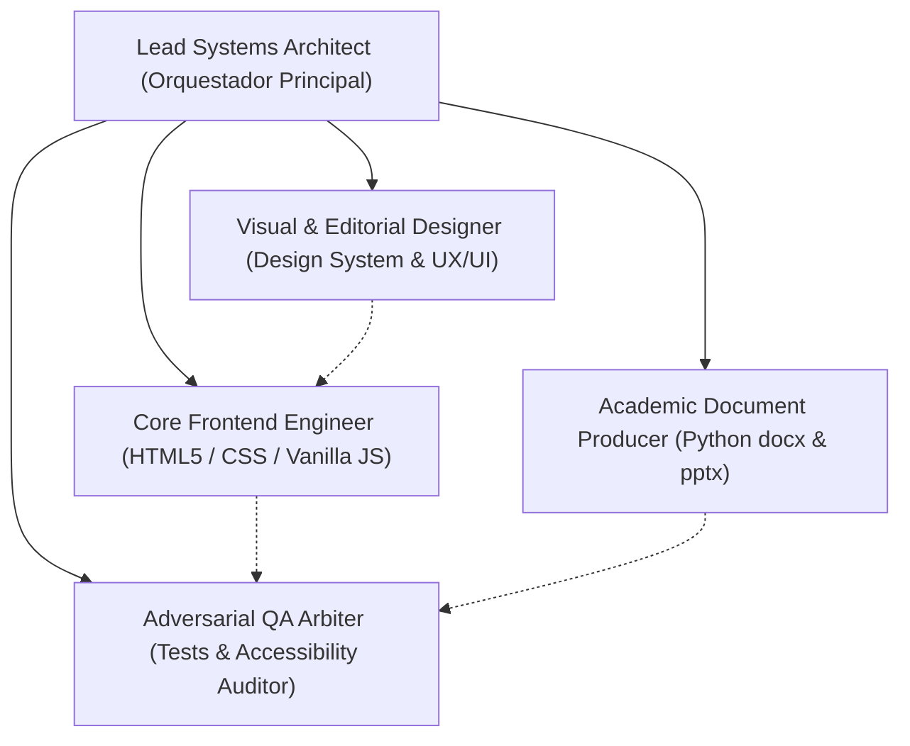

# AGENTS ARCHITECTURE & OPERATING GUIDELINES
## Proyecto Final ACA: Clásicos Morandúa (Informática y Convergencia Tecnológica - TI010)

Este documento define la taxonomía de agentes especializados, responsabilidades técnicas y protocolos de colaboración para el desarrollo, auditoría y evolución continua del proyecto de **Clásicos Morandúa** (sitio web estático, documentos académicos APA 7 y presentación ejecutiva).

---

## 1. Misión Global y Principio Rector
Construir y preservar un ecosistema digital de alta fidelidad estética (*Warm Editorial Sans* inspirado en *ORLA* y *STILL / HOME*) y excelencia académica (Rúbrica oficial CUN TI010), garantizando:
- **Cero fuentes Serif:** Prohibición estricta de `Georgia`, `Times New Roman` o `Cormorant` en slides o web en favor de `Outfit` y `Plus Jakarta Sans`.
- **Ortografía y tildes al 100%:** Acentuación rigurosa de palabras agudas, graves y esdrújulas, y distinción léxica estricta de `ñ` vs `n` (ej. `booleanos`, `bogotanos`, `artesanos`, `planos` con n; `años`, `tamaño`, `diseño` con ñ).
- **Proporción de imágenes:** Cero fotos estiradas o deformadas; uso de recorte inteligente `ImageOps.fit`.
- **Equilibrio visual en diapositivas:** Espaciado vertical armónico sin vacíos blancos excesivos en las tarjetas.
- **Cero dependencias complejas:** Despliegue directo en GitHub Pages con HTML5, CSS moderno y Vanilla JS ES Modules.
- **Algoritmia eficiente Big O:** Consultas de catálogo en $O(1)$ temporal e inserción en $O(k)$ mediante `DocumentFragment`.
- **Accesibilidad universal WCAG AAA:** Tamaño base >= 18px, botones >= 48x48px, enfoque nítido pensado para adultos mayores.

---

## 2. Taxonomía de Agentes Especializados

### 2.1. Lead Systems Architect (Orquestador)
- **Responsabilidad:** Coordinar las fases de entrega, validar la coherencia integral entre código web y documentos, y asegurar el cumplimiento de la rúbrica académica.
- **Criterio de Éxito:** Sincronización perfecta entre los requerimientos del usuario, la paleta cromática, la estructura de 5 secciones y los entregables descargables.

### 2.2. Visual & Editorial Designer
- **Responsabilidad:** Custodiar los tokens definidos en `design.md`.
- **Reglas Estrictas:**
  - Mantener la paleta cromática: Lino (`#FAF8F5`), Arena (`#F3EFEA`), Blanco Puro (`#FFFFFF`), Carbón (`#1C1917`), Madera Flor Morado (`#8B5A3C`) y Olivo (`#1F5E3B` y `#3D523D`).
  - **No-Serif Policy:** Toda la tipografía debe ser sans-serif moderna: `Outfit` para títulos y `Plus Jakarta Sans` para cuerpo y elementos interactivos.
  - Asegurar tipografía sans con espaciado amplio en kickers (`letter-spacing >= 0.18em`) y altura de línea amplia (`1.65` a `1.8`) en el cuerpo del texto.
  - Cero sombras duras, cero degradados de plástico y cero colores saturados fuera de norma.

### 2.3. Core Frontend Engineer
- **Responsabilidad:** Mantener y evolucionar la base de código web en `ACA/`.
- **Reglas Estrictas:**
  - Vanilla JavaScript puro con ES Modules nativos; prohibido introducir frameworks o bundlers pesados que rompan la ejecución directa en GitHub Pages.
  - Todo filtrado de catálogo debe resolver en $O(1)$ temporal mediante `Map` precomputado (`CATEGORY_INDEX`).
  - Toda manipulación masiva del DOM debe resolverse en $O(k)$ mediante un único `DocumentFragment` y `replaceChildren`.
  - Integración nativa de Google `<model-viewer>` para WebAR 3D con atributos `ar`, `camera-controls` y modelos `.glb` locales seguros con ranura `slot="poster"` para evitar recuadros vacíos.

### 2.4. Academic Document Producer
- **Responsabilidad:** Generar mediante `ACA/docs/generate_deliverables.py` los archivos `ProyectoFinal_Norman_Jaimes.docx` y `ProyectoFinal_Norman_Jaimes.pptx`.
- **Reglas Estrictas:**
  - Formato APA 7 estricto en Word (márgenes de 2.54 cm, sangría de 1.27 cm, numeración dinámica superior derecha, tablas con cabecera oscura y marcadores de captura `[INSERTAR CAPTURA X]`), empleando tipografía sans-serif permitida oficialmente (`Arial 11 pt`).
  - Presentación ejecutiva en PowerPoint de exactamente 10 diapositivas panorámicas 16:9 con regla del hilo conductor, 3 viñetas concisas con títulos de 15 pt bold (Outfit), cuerpo de 13.5 pt (Plus Jakarta Sans) y notas de orador completas.
  - Cero imágenes estiradas: procesamiento previo con Pillow `ImageOps.fit` centrado.
  - Cobertura exhaustiva de las 11 subsecciones obligatorias (`5.1` a `5.11`) contextualizadas a Clásicos Morandúa.

### 2.5. Adversarial QA Arbiter (Árbitro Adversarial)
- **Responsabilidad:** Auditar de forma implacable el código y los artefactos antes de dar por cerrada cualquier tarea.
- **Batería de Pruebas Obligatoria:**
  1. Suite de tests unitarios nativos de Node.js (`node --test tests/catalog.test.mjs`) pasando al 100% (0 fail).
  2. Inspección de viewport Desktop (1280x800) y Mobile (390x844) verificando `scrollWidth === clientWidth` (cero `overflow-x`).
  3. Contraste WCAG AAA verificado en todos los componentes interactivos.
  4. Auditoría anti-leaks: cero credenciales, cero rutas locales absolutas, cero textos *Lorem Ipsum* y cero guiones largos (`—` / `–`).
  5. Verificación de tamaño de archivos binarios (> 30 KB en `.docx` y `.pptx`), exportación nativa a PDF y ausencia de corrupción XML.
